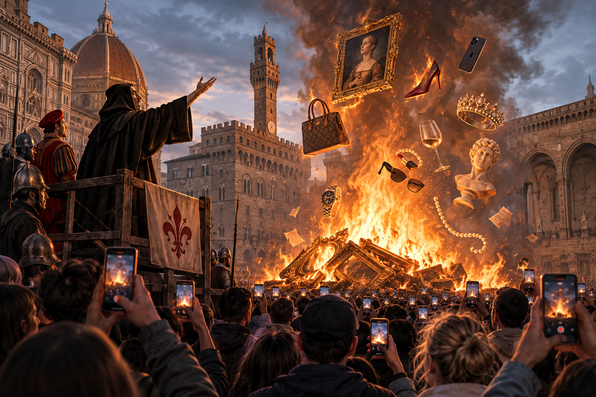

> It is not from the benevolence of the district attorney, the community leader, or the journalist, that we expect justice, but from their regard to their own self-interest. *Adam Smith, The Wealth of Nations* (paraphrased)

*Bonfire of the Vanities* is nearly 40 years old and feels like it was written yesterday. Sure, bonds and Gordon Gekko have receded from the public conscience since the heyday of Salomon Brothers, but the business of moral outrage towards those of wealth and privilege is booming. In *Bonfire*, this moral outrage is latent and it must be painstakingly orchestrated towards some end by the trifecta of grassroots organizing, the press, and the political / legal apparatus. In contrast, the past decade has witnessed many a moral crusade launched by a mere 140 characters. What interests me is what has happened to the machine Wolfe describes. The institutions Bacon had to recruit were both his megaphone and his brakes, and the Internet has removed both. Outrage no longer needs anyone's permission, and the vanity Wolfe mocks at Park Avenue dinner parties is now available for anyone with a phone to emulate and admire.

## Synopsis

Sherman McCoy is a Yale WASP working as a leading bond salesman at Pierce and Pierce. He makes over a million dollars a year and still spends more than he makes burdened by the Park Avenue apartment, the Hamptons home, the help, the wife with an expensive interior design job/hobby. He's a hard worker, but an absentee patriarch engaging in a prolonged affair with a southern dame, Maria Ruskin. He's no saint, but he's not evil either.

One night, he is picking Maria up from the airport, takes a wrong turn, and ends up in the Bronx backroads. After much panic, he finds the on-ramp to the highway back to Manhattan, but there's a tire blocking the path. He gets out of the car to move the tire when two young black boys approach the car attempting to rob him. After a brief struggle, Maria takes the wheel, picks Sherman up and peels off up the ramp, incidentally hitting one of the two boys. The boy, Henry Lamb, goes to the hospital to get his broken wrist splinted. He says nothing of the accident to the authorities because of the criminal implications. He is discharged and, a few hours later, enters a coma related to the trauma.

Reverend Bacon, a Harlem community leader, orchestrates a social movement on behalf of Henry Lamb. He reimagines Lamb as a star student with a bright future from the Edgar Allan Poe projects; Lamb is a nice kid but not destined for greatness as is suggested. Bacon enlists the media to draw attention to the story and pressures the Bronx district attorney to direct considerable resources towards an investigation. Sherman McCoy slowly becomes public enemy number one in the Bronx. His life unravels, as he is ground up by the law and the wrath of the public. Along the way, ulterior motives lead key minor characters to destroy Sherman. Bacon wants money and to exercise his power in the community. Larry Kramer, an assistant DA, wants to be a star. Abe Weiss, the actual DA, wants to be re-elected. Peter Fallow, the City Light alcoholic reporter, wants notoriety. No one is motivated by duty, or the purported ideals of their ostensibly idealistic professions. The lawyers are not concerned with justice, the press is not concerned with the truth, the community leaders are not concerned with the community, and *no one* really cares about Henry Lamb save for his mother.

## A Tribute to Dickens

Wolfe is consciously imitating Dickens and the "panoramic" social novel that characterizes an entire place in time, through its most representative characters. Like Dickens, he published *Bonfire* in serial. Rolling Stone magazine! Like Dickens, his characters are caricatures in the same way that grated me with [*David Copperfield*](/books/2025-11-11-david-copperfield/). Each *Bonfire* auxiliary character is one dimensional and can (almost) wholly be described in a single sentence. Peter Fallow is an arrogant under-achieving journalist with a drinking problem and a superiority complex. Larry Kramer is a self-conscious semi-impoverished assistant DA obsessed with fame, women, and his own sternocleidomastoid muscles. Reverend Bacon is a master manipulator of white guilt and his own community. The main difference in their approaches comes from their overall world view. Wolfe cannot overcome his cynicism. What is redeemable in 1980s New York City? If there is goodness there, it does not win. Dickens includes his token "pure" characters and they often ultimately triumph, cliche be damned. But Wolfe's one positive character, Judge Kovitsky, stands up to the mob and gets replaced during his re-election campaign because of his integrity. For this reason, I found *Bonfire* depressing to read. Wolfe's very funny, and this lightens the story to an extent. At its core, however, it is a very dark novel with a pessimistic outlook on human nature.

## Self-Interest

If each character can be summarized by a single sentence, it's because they each can be reduced to a single motive. Self-interest lies at the heart of *Bonfire*. Self-interest is the substrate, and the rest is veneer. I don't think Wolfe believes this is unique to 1980s NYC, although it may be a spike in its long history. Regardless of their end results, Kramer's public service, Bacon's social advocacy, and Fallow's muckraking are driven by self-interest. I'm not criticizing this. It's good that being a district attorney is high-status, because otherwise talented people wouldn't be drawn to it. So it goes for any other community position. But these institutions need a set of rules or norms to keep the self-interest in check. The courthouse has its "favor bank." The newspaper has its ombudsman. But Wolfe presents self-interest with those checks worn down to nothing, and the result is dystopia. When employed by the community leaders, you get a bad combination of hypocritical moral righteousness and the immunity that comes. In other words, these people speak with the moral authority of their virtuous (perhaps) professions, but given their positions, they are not scrutinized as much as say a Wall Street banker would be. They are assumed to be sincere, which makes it all the easier for them to be duplicitous.

## The Outrage Machine, Then and Now

One thing that struck me as quaint was how challenging it was for an individual to act on his self-interest. The possibilities of one's own self-interest were once so limited! In *Bonfire*, Bacon needs a lot of help. He needs to coordinate with the local news station to air and amplify his astroturfed protests. That's not enough by itself; he also needs a shameless journalist to control the written narrative and lend the imprimatur of the City Light to the cause. He needs the right political climate: a desperate white District Attorney in a campaign year. And even so, the movement is bounded by the local NYC news loop, although Wolfe hints at its spread when it finally hits the New York Times, it only makes section B. How much trouble people once had to go through to orchestrate social change! But the trouble served an important function. Each institution was a check on Bacon, with its own interests and reputation to protect, ultimately providing friction that is an important guardrail.

The Internet has substantially changed these dynamics by both lowering the "activation energy" of a movement and, relatedly, reducing the momentum. Today, Bacon would post a 30-second outrage-inducing video. His followers would echo it, it would get picked up by some news outlets, and then it would likely fizzle out as the next "current thing" took its place. This is significant in a few ways. First, institutions are not necessary, as they are in *Bonfire*. The Internet gives an individual the opportunity to build their own platform and scale beyond physical limits; Reverend Bacon was confined to upper Manhattan and those he could control. It was hard for him to scale; he needed the press to amplify his ideas. Second, outrage no longer has to manifest physically. In Bacon's day, to "release the steam," people had to congregate in person. It was not possible for the angry community members to "drag" Sherman McCoy online. The modern Sherman McCoy doesn't have a protest outside his luxury apartment; he has an army of online activists saying mean things about him on social media and calling his employer to get him fired. The steam can be let out virtually, or at least remotely.

While a social movement is more easily initiated with Internet era communication and thus there are more movements, the flip side is many of these movements are minor. It's a natural tradeoff. There is a finite amount of appetite for activism. As the causes increase in number, the effort put into each must decrease to an extent. This is well-observed in the physical manifestation of a movement. Sticking with Manhattan as an example, recall Amy Cooper, the "Central Park Karen" who was cancelled for threatening a black birdwatcher who wanted her to put her dog on a leash. The altercation was recorded and animated the country during the Covid doldrums. It's forgettable now, but there was nothing physical about this event. Amy Cooper was fired and ostracized online, and probably harassed when she was in public, but there were no protests on behalf of birdwatchers. The steam was released on Twitter and the world moved on quickly to the next thing. By contrast, the most salient events do transition to the physical world. The Occupy Wall Street movement led to nationwide protests and a two month occupation of Zuccotti Park, a few blocks from where Sherman would have worked. Yet even Occupy, leaderless and without clear demands, was gone within months.

## Bonfire, or Exaltation?

So where does all the steam go? Wolfe's title suggests it burns something. The namesake of the book was a historical event in 1497 Florence, where the friar Girolamo Savonarola presided over the public burning of art, cosmetics and sinful books. At first glance, Bacon's crusade may seem similar. The people of New York unite. The public servants listen to the people. The little guy is finally heard and he has taken down Sherman McCoy, poster boy for the WASP elite class. But there is no purification and no wealth is destroyed. Rather, it's redirected. It is superficially a bonfire, but really it's an exaltation. It flows from Sherman McCoy to Killian in legal fees, to Mrs. Lamb in settlements. It's transmogrified into prestige for Peter Fallow and political capital for Abe Weiss. Vanity, it turns out, is all there is.

Wolfe makes this pervasive vanity pretty clear as you run down the characters, and it's true across class barriers. Among the elites, the vanity is more obvious. Sherman is the "Master of the Universe." The dinner at the Bavardages' reveals the Social X-Rays, wealthy housewives who are as thin as skeletons and the Lemon Tarts, second (trophy) wives and girlfriends of rich older men, like Maria Ruskin. It's true of the middle class as well. Larry Kramer is ashamed of his standing. He went to a good law school and he lives in a shitty apartment barely earning enough money to eke out a middle class life. He has the humiliating (to him) and dangerous public transit to the courthouse. Even at the dregs of society, Roland, the ring leader in the attempted Sherman robbery, has to have a pristinely white pair of Nike Air Force Ones on at all times. The clergy, too, is filled with vanity. Reverend Bacon runs a securities firm and extorts the Episcopalians trying to invest in the community. We never see him give back to the community; we only see him use and extract to obtain power and wealth.

With this thread, Wolfe identifies an interesting phenomenon that has only grown in relevance as American society appears to waver over whether vanity is sin or virtue. There is a contradiction where people both despise and admire vanity. Many people feel a contempt for the ultra-rich in the abstract. Indeed, the richest Americans seem to be hated no matter what they put their capital towards. Some buy mega yachts and make the city of Venice their wedding venue. Others try to rid the world of malaria. The two receive public contempt all the same! But in contemporary America, where the average person is wealthy enough to have an iPhone and an SUV, vanity and excess is very much mainstream. The "influencer" archetype is a person with a particular interest or niche that demonstrates conspicuous consumption. G-Wagons, shopping hauls, extravagant vacations, ostentatious matching workout sets, guns. Veblen goods, where demand increases as cost increases, pervade even the most ordinary markets. We have grocery stores popular only because they're expensive. You can get $30 chicken tenders! Botox is up 800% since the year 2000, and common even among young women these days. Vanity is incredibly mainstream and becoming more so.

This is where outrage and vanity meet. The same scroll that shows you the billionaire's Venice wedding to resent shows you a shopping haul to envy a minute later. They both compete for your attention, our modern currency of status. In 1987 you needed the fancy job to be Sherman, or the church and newspaper to be Bacon. Today, anyone can be either.

## Conclusion

The actual Bonfire of the Vanities ended a year later with Savonarola himself hanged and burned in the same square where the vanities were consumed. Wolfe offers no such comeuppance. Bacon keeps his power, Fallow gets his flowers, Weiss is re-elected and Kovitsky, the one admirable man, loses his job.

Adam Smith knew self-interest alone is not enough. In *The Theory of Moral Sentiments*, he argues that society is held together by the "impartial spectator" in our heads, the habit of judging our own conduct as a fair observer would. This self-consciousness about our conduct is relevant and spares us from the excesses of self-interest. *Bonfire* is a world without moral sentiments. Each character is watched by the public but not by their own conscience. The Internet has given us more spectators than Wolfe could have imagined, but they are far from impartial.
